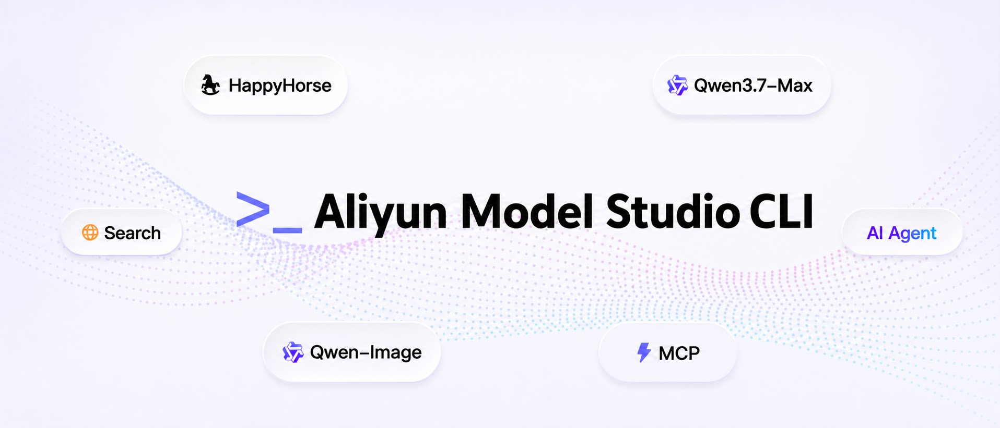
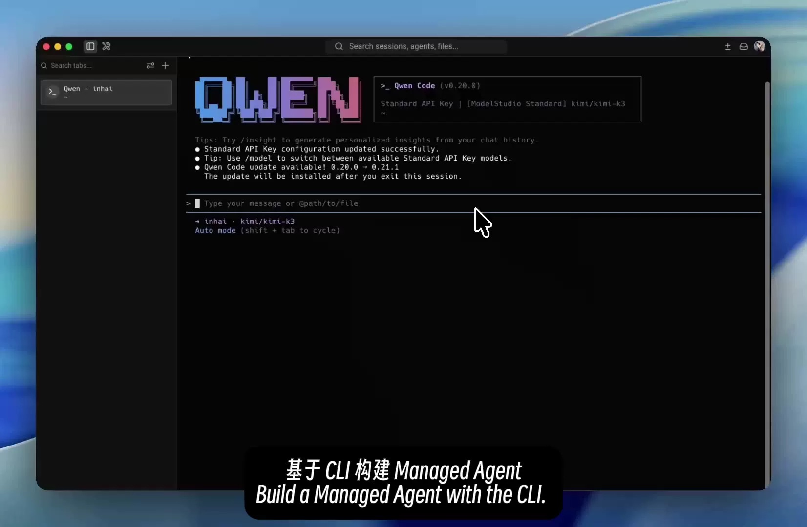
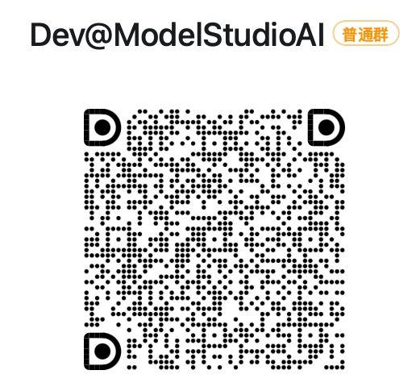

<div align="center">



**The official command-line interface for Aliyun Model Studio (DashScope) AI Platform**

[](https://www.npmjs.com/package/bailian-cli)
[](https://nodejs.org)
[](https://www.typescriptlang.org)
[](LICENSE)

[Aliyun Model Studio CLI Site](https://bailian.console.aliyun.com/cli?spm=a2ty07.github) · [中文文档](https://github.com/modelstudioai/cli/blob/main/README.zh.md) · [API Documentation](https://help.aliyun.com/zh/model-studio/) · [Get API Key](https://bailian.console.aliyun.com/cn-beijing/?spm=a2ty07.github&tab=app#/api-key)

---

_Chat with Qwen, generate and edit images and videos, understand images, synthesize_
_and recognize speech, call apps, manage memory, retrieve knowledge, search the web —_
_every AI capability, one command away._

_Built for AI Agents. Every command works as a structured tool call._

</div>

## Features

- **Model generation** — Full-modality generation across text, image, video, and speech, with editing and reference-based generation
- **Asset understanding** — Parse and ask questions about images, documents, audio, and long videos
- **App orchestration** — Call Managed Agents, agents, and workflows published on Aliyun Model Studio, wired to knowledge bases, memory, web search, and MCP tools; create, update, publish, copy, and delete agents/workflows, and edit workflow canvases from the CLI
- **Native MCP setup** — Register Bailian MCP servers in Codex, Claude Code, Cursor, Qoder, Qoder Work, QwenWork (千问办公), Qwen Code, Gemini CLI, or Pi
- **Training & deployment** — Validate and upload datasets, fine-tune models, deploy dedicated models as endpoints
- **Batch inference** — Prepare CSV/JSONL, create and follow asynchronous Chat/Embedding tasks, download original results/errors with optional CSV, or send one synchronous Batch Chat request
- **Account operations** — Login, UI-based configuration, model marketplace, usage and quota, rate-limit increases, team seat management
- **Plan onboarding** — Connect subscription plans such as Token Plan to the CLI and common coding agents in one step

> **Note:** App orchestration, native MCP setup, training & deployment, account operations, and plan onboarding are currently available only to China site (aliyun.com) account holders and are not yet supported for international / global site accounts.

## Showcase 1: A Cinematic Short Film from One Sentence

<p align="center">
  <a href="https://cloud.video.taobao.com/vod/dS2F4huqbw5Nfe5L3wwb3grz2q2DNYD3retq8dU-iHo.mp4">
    
  </a>
</p>

<p align="center"><i>👆 Click the cover to play the full 2-minute demo</i></p>

A complete **2-minute, 16:9 cinematic short film** — produced end-to-end from a single natural-language sentence, with **zero manual editing**. This showcase demonstrates how an AI Agent can compose a multi-step creative pipeline by orchestrating three primitives:

- **[Qwen Code](https://github.com/QwenLM/qwen-code)** — the agentic coding model that interprets the user's intent and drives the workflow
- **[Aliyun Model Studio CLI](https://github.com/modelstudioai/cli/)** — invokes **HappyHorse 1.1**, Aliyun Model Studio's text-/image-/reference-to-video generation model
- **[spark-video Skill](https://github.com/JohnKeating1997/spark-video)** — handles scene decomposition, storyboarding, shot continuity, and final stitching

### The single prompt

> _"Generate a roughly 2-minute video in Japanese cinematic style — a sweet, innocent first-love story about a high-school girl. The plot should be heart-fluttering enough to make viewers want to fall in love. Aspect ratio: 16:9."_

## Showcase 2: A Short-Film Director Managed Agent from One Sentence

<p align="center">
  <a href="https://cloud.video.taobao.com/vod/2v0GYLbJSQb2saj4iopTJDW3iRIHsintYlK-wTKbhqE.mp4">
    
  </a>
</p>

<p align="center"><i>👆 Click the cover to play the full demo</i></p>

One sentence builds a reusable cloud-side short-film director for storyboarding, storyboard image generation, and video creation:

- **[Qwen Code](https://github.com/QwenLM/qwen-code)** — understands the requirement and generates the agent configuration
- **[Aliyun Model Studio CLI](https://github.com/modelstudioai/cli/)** — validates the configuration, previews the changes, and completes the deployment
- **[Managed Agent](https://bailian.console.aliyun.com/cn-beijing/?spm=a2ty07.github&tab=managed-agents#/managed-agents/quick-start)** — runs the director role along with its skills and tools in the cloud

### The single prompt

> _"Build me a Managed Agent app that can produce short films — a director expert that generates videos and can also design the matching storyboards."_

## Installation

**Agent install (recommended)**

Send the following to your Agent — it will detect your environment, then install and verify the CLI for you:

```text
Please read https://bailian.aliyun.com/cli/install.md and install the Aliyun Model Studio CLI for me
```

**Install with NPM**

```bash
npm install -g bailian-cli
bl skill init
```

> Requires Node.js >= 18.17.

**Install on macOS/Linux**

```bash
curl -fsSL https://bailian.aliyun.com/cli/install.sh | bash
```

> No Node.js required. The installer automatically installs Bailian Skills.

**Install on Windows**

```powershell
irm https://bailian.aliyun.com/cli/install.ps1 | iex
```

> No Node.js required. The installer automatically installs Bailian Skills.

## Quick Start

Once installed, just describe your task to your AI Agent — no need to assemble commands by hand.

| Scenario                 | What to say to your Agent                                                                                                             |
| ------------------------ | ------------------------------------------------------------------------------------------------------------------------------------- |
| Managed Agent            | "Create a Managed Agent that can generate short-film storyboards and videos."                                                         |
| Image & video generation | "Generate an image of a cat in a spacesuit on Mars, then turn it into a video."                                                       |
| Speech recognition       | "Transcribe this audio; if proper nouns are wrong, add hot words and try again."                                                      |
| Usage & quota            | "Show my recent model usage, free-tier quota, and rate limits."                                                                       |
| Monitoring & alerts      | "Show my model call stats, failures and logs, and create an alert rule."                                                              |
| Throughput reservations  | "List my throughput reservations and capacity instances, then scale, renew or release capacity and wait for the operation to finish." |
| Model selection          | "Recommend a model for image understanding and customer support."                                                                     |
| Decision model           | "Use the Bailian decision model to route this ticket and assess whether it needs escalation."                                         |
| About Bailian CLI        | "Tell me what Bailian CLI can do for me, and suggest how to use it for my needs."                                                     |

> More examples and scenarios: [Aliyun Model Studio CLI Site](https://bailian.console.aliyun.com/cli?spm=a2ty07.github)

### Try a knowledge base

With a valid API key and workspace, preview initialization first:

```bash
bl knowledge init --workspace-id <workspace-id> --dry-run
```

Knowledge bases accrue running-time charges from creation, even without queries. The one-time Standard Edition 720-hour allowance is shared across knowledge bases and expires 30 days after activation for new users. Model calls cost extra; your remaining allowance is unknown. Review the plan and [billing rules](https://help.aliyun.com/zh/model-studio/billing-for-knowledge-base), then add `--yes` to the same command **after confirming the operation**, removing `--dry-run` to execute.

Keep the returned IDs and recovery record. Closing the CLI or a later failure does not stop billing; follow the reported cleanup actions to delete unused knowledge bases. See the [Knowledge Studio quick start](packages/kscli/README.md#quick-start) for retrieval and cleanup. The `bailian-knowledge` Skill is available through `bl skill init`.

### Console dataset and deployment queries

```bash
bl dataset groups --page 1 --page-size 10 --output json
bl dataset version --dataset-group-id <group-id> --output json
bl dataset version --dataset-id <version-id> --include-status --output json
bl file url --file-key <console-file-key> --output json
bl deploy instances --page 1 --page-size 10 --output json
```

Use `dataset groups` (`--name` optionally filters on the server) to obtain `records[].datasetGroupId`, then `dataset version --dataset-group-id <group-id>` to get `{result:[...]}` with `result[].datasetId` and its optional `fileId`. Use `dataset version --dataset-id <version-id>` for details; `--include-status` is available only in detail mode. Exactly one of `--dataset-group-id` and `--dataset-id` is required; they cannot be combined. `fileId` is not `datasetId` and must not be passed as a version ID. Groups fetch one page with one embedded version preview per group; `version --dataset-group-id` does not promise exhaustive results or expose pagination. The API Key / `file_id` semantics of `dataset list` are unchanged.

These read-only commands use Console authentication. An optional `--workspace-id` resolves the workspace's Console identity before querying; resolution failure stops the request. `dataset version --dataset-id` keeps metadata and version/task state separate and does not infer validation success or training readiness. `file url` only resolves a download address. `deploy instances` returns one page of independent services (`records` is the list, `items` the total), not capacity instances. The API-key `dataset get --file-id` and `deploy list` commands are unchanged. Add `--dry-run` to preview without business requests; framework update checks/telemetry follow their settings.

### RAG audio and video

`bl knowledge doc import --index-id <id> --doc-id <fileId>` imports an existing file into a knowledge base; `doc list --details` shows per-file processing settings. Media support includes parser options, streaming uploads, and media references in search/chunk output. Chat JSON separates the final answer from phases, tools, docs, usage, and raw events; quiet mode hides progress and informational messages while preserving the final result, including every JSON field. See the [command guide](docs/knowledge/knowledge-cli-guide.md).

## ParseX

Parse documents or audio/video and extract structured fields through the workspace-scoped ParseX API:

```bash
bl parsex parse submit --workspace-id <workspace-id> --file-url "https://example.com/document.pdf" --file-name document.pdf --output-file-format markdown --output json
bl parsex parse result --workspace-id <workspace-id> --biz-id <parse-biz-id> --follow --output json
bl parsex extract submit --workspace-id <workspace-id> --parsed-file-biz-id <parse-biz-id> --schema-file schema.json --output json
bl parsex extract result --workspace-id <workspace-id> --biz-id <extract-biz-id> --follow --output json
```

Use an ordinary API key and a workspace with ParseX access. Submission returns `data.biz_id` immediately; `result --follow` waits for completion. `schema.json` contains a JSON Schema object, for example `{"type":"object","properties":{"title":{"type":"string"}}}`. Inputs are accessible HTTP(S) URLs; extraction also accepts a retained document parsing task. See the [ParseX command guide](docs/parsex.md) for processing options, result slices, OSS credentials, dry-run and polling behavior.

## Batch Inference

```bash
bl batch convert --help
bl batch convert --file input.csv --output-file input.jsonl --model qwen-plus
bl batch create --file input.jsonl --dry-run
bl batch create --file input.jsonl
bl batch get --batch-id <id> --follow
bl batch download --batch-id <id> --csv
bl text chat --batch --model qwen-plus --message "Hello" --timeout 3600
```

`--help` includes CSV, JSONL and result data examples. `convert` is local and needs no key; inference/task commands use a model API key. File inference uses asynchronous tasks via `create → get → download`: `create` uploads/submits and returns a task ID without waiting for completion. Query with `get` and download results after completion. Conversion/download files are atomically published per file and never silently overwritten. Use `--force` to recover partial downloads. JSONL is the authoritative result, while CSV is a lossy display; import IDs as text to preserve leading zeros. Ctrl-C stops local polling, not the remote task.

`text chat --batch` sends one synchronous request and waits for its response; it does not create an asynchronous task ID. Use `--message` or `--messages-file`, which contains one request's conversation context, not independent file requests. The total request timeout defaults to 300 seconds (`--timeout`: 60–3600 seconds). Timeout/Ctrl-C/disconnection do not guarantee server cancellation.

Synchronous Batch Chat is non-streaming; explicit realtime/international/Token Plan endpoints are rejected. An explicit realtime profile requires `--base-url https://batch.dashscope.aliyuncs.com`. Batch availability and limits depend on the service/model. Dry-run avoids business requests and output/directory writes; framework update checks/telemetry follow their settings.

## Authentication

### Console Login (OAuth, Recommended)

Required for console capability commands (model list, flow-agent list, workspace, usage queries, rate-limit increases, direct console calls). It can create an ordinary API key when needed. Token Plan and other subscription plans cannot use `--console`; use the API Key login below.

```bash
bl auth login --console
```

Use `--console-site international` for the international console.

The CLI always prints the login URL. To choose a browser yourself, keep the command running and open the URL on the **same machine**:

```bash
bl auth login --console --no-browser --console-site international
```

If the browser blocks the local callback, check the console site's local-network permission or try Firefox. The PNA compatibility header does not bypass Chrome's local-network permission or Safari's mixed-content restrictions. No callback within 15 minutes is a failure (exit code 5), not a successful login.

If you already have a valid console access token, import it via stdin without a browser or local callback server. Specify the token's actual region and site; for example, in a POSIX shell:

```bash
bl auth login --console --token-stdin --console-site international --console-region ap-southeast-1 < /path/to/console-token.txt
```

Input must be one raw token (up to 64 KiB), not JSON or `Bearer ...`; interactive terminal input is rejected to avoid echoing secrets. Use a protected file or trusted pipe, never put the token in command arguments or shell history, and remove temporary secret files after use. The CLI validates the token before saving; failure leaves existing credentials and the active Profile unchanged. Add `--config <name>` to save and activate a specific Profile on success. This imports only the console session, not a model API key.

### API Key

Cloud Skill commands use the configured workspace ID to build the Beijing workspace endpoint. Set it once with `bl config set workspace_id <id>`, or use `BAILIAN_WORKSPACE_ID` or `--workspace-id`. An explicit model base URL (flag, environment or profile) takes precedence.

Search the cloud Skill catalog with a Bailian API key, for example `bl skill search --keyword pdf --type official`. Pass a returned `skill_code` to `bl skill get --name <skill_code>` to see the latest version and local installation paths. Omit `--type` to include private skills in your workspace. `skill get` also reads MCP server codes from the latest package’s `mcp-config.json` by default. Use `--with-mcp false` to skip the package download.

Install a search result with `bl skill add --name <skill_code> --agent cursor --scope project`. Add `--skill-version 1.0` to pin a version. `bl skill list --scope project` shows installation paths and states. Preview updates with `bl skill update --name <skill_code> --scope project --diff --dry-run` and omit `--dry-run` to apply. `bl skill remove --name <skill_code> --agent cursor --scope project` removes that local installation offline. These four commands default to the cloud OpenAPI. Pass `--source oss` to manage skills from the public OSS registry.

Skill commands check unpinned installations from the selected source and report available updates on stderr. The check reuses catalog reads and caches revisions for 24 hours. Removal uses the cache offline. Run `bl skill update` to apply an update, or add `--source oss` for the public registry.

Installation checks declared MCP dependencies by default. Use `--dry-run` to see which services need activation and `--yes` to confirm potential charges. To install only the Skill, pass `--with-mcp false`.

Use an ordinary Bailian API key to list activated MCP servers (`bl mcp list`), inspect server details and tools (`bl mcp get --server <code>`), and manage custom servers (`bl mcp create`, `update`, `delete`). Use `--dry-run` to preview changes. Creating a server, replacing its configuration, and deleting it require `--yes`.

Search for tools with a natural-language query, for example `bl mcp tool search --query "look up an order" --limit 5 --yes`. Search requires confirmation because recommendations can trigger OneKey activation. For a known server, use `bl mcp tool list --server <code>` to read its tools and input schemas through OpenAPI. Add `--yes` for OneKey or unknown activation policies. Both commands support a local `--dry-run` preview. To inspect tools through an MCP session, use `bl mcp tools --server <code>` with an optional `--url <endpoint>`.

To call a tool through OpenAPI, run `bl mcp tool call --server <code> --tool getOrder --arg orderId=A123`. Use `--dry-run` to preview the arguments and `--yes` to confirm possible OneKey activation. To call through an MCP session, use `bl mcp call --target <code>.getOrder --arg orderId=A123`. Both commands apply `--json` first, then repeated `--arg` values, and finally `--query` as text.

Use `bl mcp activate --server <code,...>` or `bl mcp deactivate --server <code,...>` for up to 30 distinct official or custom servers. Preview with `--dry-run` and confirm changes with `--yes`. OneKey activation may place an order. Stopping a custom server keeps its saved configuration.

Use `bl mcp connect --server <code> --transport streamable-http --agent cursor` to register the workspace endpoint. For an inactive service, `--yes` confirms activation and `--and-activate=false` skips activation. Add `--scope project` from the project root for project-level registration. Agent config files and backups can contain your API key. `bl mcp disconnect --server <code> --agent cursor` removes the matching local registration offline. Use the same scope for both commands.

To use an existing ordinary API key or a Token Plan subscription key, run the same command:

```bash
bl auth login --api-key <API_KEY>
```

Get an ordinary key from the [DashScope Console](https://bailian.console.aliyun.com/cn-beijing/?spm=a2ty07.github&tab=app#/api-key), or a Token Plan key from the [subscription overview](https://bailian.console.aliyun.com/cn-beijing?spm=a2ty07.github&tab=plan#/efm/subscription/overview).

### Alibaba Cloud OpenAPI AK/SK

Token Plan seat and member management requires an Alibaba Cloud AccessKey. Get yours from the [RAM Console](https://ram.console.aliyun.com/manage/ak).

> Recommended: create a RAM sub-account with minimum privileges instead of using the root account's AK/SK.

```bash
bl auth login --open-api --access-key-id LTAI5t... --access-key-secret ...
```

## Configuration

```bash
# View current config
bl config show

# List all config profiles
bl config list

# Switch config profile
bl config use --name token-plan

# Switch the CLI interface to Chinese
bl config set --key language --value zh-CN
```

Config file location: `~/.bailian/config.json`

## Update

```bash
bl update
```

Upgrades the CLI to the latest version and refreshes the installed Agent Skills. Release notes for every version live in [CHANGELOG.md](https://github.com/modelstudioai/cli/blob/main/CHANGELOG.md).

## Contributing

Bug reports, feature requests, and PRs are welcome. See [CONTRIBUTING.md](https://github.com/modelstudioai/cli/blob/main/CONTRIBUTING.md) for developer setup, repo layout, and the workflow for adding or changing commands.

Scan the QR code to join the Aliyun Model Studio CLI DingTalk user group for usage help, troubleshooting, bug reports, and tips from other users.



## Links

Memory documentation (Chinese): [capability matrix](https://github.com/modelstudioai/cli/blob/main/docs/memory/cli-matrix.md) · [command guide](https://github.com/modelstudioai/cli/blob/main/docs/memory/memory-cli-guide.md).

| Resource                     | URL                                                                                                 |
| :--------------------------- | :-------------------------------------------------------------------------------------------------- |
| Aliyun Model Studio CLI Site | https://bailian.console.aliyun.com/cli?spm=a2ty07.github                                            |
| DashScope API Docs           | https://help.aliyun.com/zh/model-studio/                                                            |
| Qwen Model List              | https://help.aliyun.com/zh/model-studio/getting-started/models                                      |
| Aliyun Model Studio Console  | https://bailian.console.aliyun.com/?spm=a2ty07.github                                               |
| Get API Key                  | https://bailian.console.aliyun.com/cn-beijing/?spm=a2ty07.github&tab=app#/api-key                   |
| Get Token Plan API Key       | https://bailian.console.aliyun.com/cn-beijing?spm=a2ty07.github&tab=plan#/efm/subscription/overview |
| Get AccessKey                | https://ram.console.aliyun.com/manage/ak                                                            |
