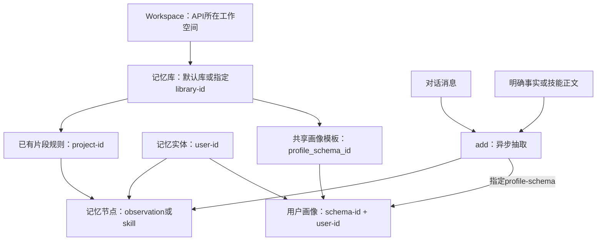

# `bl memory` 命令完整用法指南

`bl memory` 用于写入和检索长期记忆、维护记忆节点、管理画像模板并读取用户画像，以及导出Skill记忆。本指南覆盖当前源码的全部 **13个公开命令**，按“总览＋分领域手册”组织；详细参数与示例见各手册。

## 目录

1. [核心概念与实体关系](#核心概念与实体关系)
2. [通用约定](#通用约定)
3. [典型工作流](#典型工作流)
4. [命令速查与分领域手册](#命令速查与分领域手册)
5. [常见错误与排查](#常见错误与排查)

## 核心概念与实体关系



| 对象      | 含义                                      | CLI中的标识                                     |
| --------- | ----------------------------------------- | ----------------------------------------------- |
| Workspace | 决定服务请求域名                          | workspace-id                                    |
| 记忆库    | 记忆数据所在库                            | library-id；省略使用默认库                      |
| 片段规则  | 决定抽取规则、observation/skill等记忆类型 | project-id；不是本地项目路径                    |
| 记忆实体  | 业务用户或其他记忆归属对象                | user-id；不是API Key，也不是独立鉴权机制        |
| 记忆节点  | 一条事实或技能记忆                        | 响应memory_node_id，对应node-id                 |
| 异步事件  | 一次提交及其抽取任务                      | event_id；不是节点ID                            |
| 画像模板  | 共享属性定义                              | profile_schema_id，对应schema-id/profile-schema |
| 用户画像  | 某个用户在某模板下已抽取的属性值          | schema-id + user-id                             |

CLI使用已有记忆库与规则ID，不提供它们的创建、更新或删除命令。记忆检索直接返回相关节点，不生成聊天回答；当前也没有 `memory chat` 命令。完整接口和范围映射见[能力矩阵](cli-matrix.md)。

## 通用约定

### 安装与鉴权

安装方式见[安装说明](../../INSTALL.md)。先检查本机命令是否与文档一致：

```bash
bl --version
bl memory --help
bl memory search --help
```

所有Memory命令使用API Key鉴权。可用环境变量配置，避免在示例中写入真实凭证：

```bash
export DASHSCOPE_API_KEY='<your-api-key>'
export BAILIAN_WORKSPACE_ID='<your-workspace-id>'
```

API Key可通过 `--api-key`、环境变量或配置提供。Workspace解析顺序为 `--workspace-id` > `BAILIAN_WORKSPACE_ID` > 配置中的 `workspace_id`；所有Memory命令均需要解析出Workspace。

当前请求地址为 `https://{workspace-id}.cn-beijing.maas.aliyuncs.com/api/v2/apps/memory/...`，Workspace只允许字母、数字、连字符和下划线。通用 `--base-url` 不替换此组命令的Workspace绝对地址。

### 范围参数

- 示例默认使用默认记忆库；指定库时，在支持的命令中保持同一个library-id。
- `node show`、`skill export` 不接受library-id，依靠节点ID和Workspace定位。
- add/search/list及profile get需要user-id；节点更新、删除和详情不接受user-id。
- list的project-id是单个规则；add可重复，内容直存最多1个、消息抽取最多5个；search推荐使用可重复的project-ids。
- search支持memory-types，默认仅observation。list不传project-id时仅查询默认规则。

### 全局参数与输出

| 参数                              | 用途                                                      |
| --------------------------------- | --------------------------------------------------------- |
| `--output text` / `--output json` | 选择终端文本或结构化输出；脚本显式使用json                |
| `--api-key <key>`                 | 指定API Key                                               |
| `--workspace-id <id>`             | 指定Memory所在工作空间                                    |
| `--config <name>`                 | 使用指定配置profile                                       |
| `--timeout <seconds>`             | 请求超时；与add的抽取等待预算wait不同                     |
| `--quiet`                         | 仅隐藏过程提示，保留所选格式的完整最终结果                |
| `--verbose`                       | 输出诊断信息；保存日志时注意内容和凭证保护                |
| `--dry-run`                       | 预览endpoint、method和适用的request，不发送Memory业务请求 |

text输出便于终端查看，格式按命令不同。json通常保留服务响应；add等待完成时输出提交request_id、event_id与轮询events的组合对象。`--quiet` 可与 `--output json` 组合使用，不会改变 JSON 结构或裁剪最终结果。

JSON参数接收参数文本，不支持 `@file`：messages、attributes、attributes-operations为对象数组；meta-data为对象。数组型flag（例如skill-tags）通过重复flag传递。示例以POSIX shell为准，参数中的尖括号ID必须替换。

### 删除确认与dry-run

`memory delete`、`memory profile delete` 实际执行需要 `--yes`。不带时返回退出码7，不弹交互式Y/N；dry-run无需确认。`profile update` 的显式属性delete操作修改共享模板定义，没有额外确认门，应先审阅操作对象与请求。

所有Memory命令支持dry-run，但它不验证真实服务鉴权、资源存在性、抽取结果或规则类型。

### 异步完成和退出码

add默认等待120秒，`--wait 0`只返回提交回执。事件ID不是节点ID；空事件不是完成证明。超时表示CLI停止等待，后台可能仍在运行，先查询结果再决定是否重试。

| 退出码 | 含义                                               |
| ------ | -------------------------------------------------- |
| 0      | 命令成功；wait=0仅表示提交阶段成功，不代表记忆落地 |
| 1      | 一般错误或服务端错误，包括部分异步任务失败         |
| 2      | 命令用法或本地参数校验错误                         |
| 3      | 本地鉴权凭证缺失等鉴权阶段错误                     |
| 6      | 网络连接类错误                                     |
| 5      | 客户端请求或等待超时                               |
| 7      | 需要确认高风险操作                                 |

服务端HTTP或业务错误保留服务信息，不因为HTTP401/429等状态改写成CLI本地错误类别。脚本同时检查退出码、stdout和stderr；退出非零时可能已经产生部分远端结果。

## 典型工作流

### 场景A：保存事实并召回

```bash
bl memory add --user-id demo_user --content '用户周末喜欢骑行。' --wait 180 --output json
bl memory list --user-id demo_user --output json
bl memory search --user-id demo_user --query '周末活动偏好' --plan-version pro --min-score 0.3 --output json
```

min-score默认0.3，**仅pro生效**；省略plan-version时默认为pro。lite示例不传分数阈值：

```bash
bl memory search --user-id demo_user --query '周末活动偏好' --plan-version lite --top-k 5 --output json
```

### 场景B：从对话抽取事实和画像

```bash
# 记录返回的profile_schema_id，替换后续占位符
bl memory profile create --name travel_profile \
  --attributes '[{"name":"city","description":"常住城市"},{"name":"hobby","description":"兴趣"}]' \
  --plan-version lite --extract-scene efficient --output json

bl memory add --user-id demo_user --profile-schema '<schema-id>' \
  --messages '[{"role":"user","content":"我住在杭州，周末喜欢骑行。"}]' --output json

bl memory profile get --schema-id '<schema-id>' --user-id demo_user --output json
bl memory search --user-id demo_user --query '用户居住地和兴趣' --output json
```

只需要画像时，在add中增加 `--extract-mode profile_only`。模板show读取定义，profile get读取指定用户的值；创建模板本身不提取画像。

### 场景C：更正和删除节点

```bash
# 将list/search返回的memory_node_id代入
bl memory node show --node-id '<node-id>' --output json
bl memory update --node-id '<node-id>' --content '用户现在更喜欢游泳。' --output json
bl memory node show --node-id '<node-id>' --output json
bl memory delete --node-id '<node-id>' --dry-run --output json
# 确认目标后执行
bl memory delete --node-id '<node-id>' --yes --output json
bl memory list --user-id demo_user --output json
```

节点更新不会同步编辑用户画像；节点删除不清空画像值或模板。已删除节点的详情仍可能显示status=delete。

### 场景D：维护和导出Skill记忆

先取得已有skill规则ID，按[Skill手册](skill.md#写入检索和更新skill节点)完成写入和检索，再使用返回的节点ID：

```bash
bl memory skill export --node-id '<skill-node-id>' --output text > meeting-summary.md
bl memory skill export --node-id '<skill-node-id>' --output json > meeting-summary.json
```

text为不含frontmatter的正文；JSON保留技能元数据。导出不会安装到任何Agent宿主。

## 命令速查与分领域手册

| 命令                       | 功能                      | 完整参数、约束、输出与示例                      |
| -------------------------- | ------------------------- | ----------------------------------------------- |
| `bl memory add`            | 内容直存 / 消息与画像抽取 | [写入](add.md#bl-memory-add)                    |
| `bl memory search`         | 语义召回                  | [检索](search.md#bl-memory-search)              |
| `bl memory list`           | 分页列举节点              | [节点列表](node.md#bl-memory-list)              |
| `bl memory node show`      | 节点详情                  | [节点详情](node.md#bl-memory-node-show)         |
| `bl memory update`         | 更新节点正文与元数据      | [节点更新](node.md#bl-memory-update)            |
| `bl memory delete`         | 删除单个节点              | [节点删除](node.md#bl-memory-delete)            |
| `bl memory profile create` | 创建画像模板              | [创建模板](profile.md#bl-memory-profile-create) |
| `bl memory profile list`   | 分页列举模板              | [模板列表](profile.md#bl-memory-profile-list)   |
| `bl memory profile show`   | 查看模板属性定义          | [模板详情](profile.md#bl-memory-profile-show)   |
| `bl memory profile update` | 更新模板属性和抽取配置    | [模板更新](profile.md#bl-memory-profile-update) |
| `bl memory profile delete` | 删除共享模板              | [模板删除](profile.md#bl-memory-profile-delete) |
| `bl memory profile get`    | 读取用户画像              | [读取画像](profile.md#bl-memory-profile-get)    |
| `bl memory skill export`   | 导出技能记忆              | [Skill导出](skill.md#bl-memory-skill-export)    |

这些路径属于 `bl memory`，不套用Knowledge文档中的kscli路径。详细API映射见[能力矩阵](cli-matrix.md)，由元数据生成的英文参数参考见[命令reference](../../skills/bailian-memory/reference/memory.md)。

## 常见错误与排查

| 现象                        | 检查方法                                                      |
| --------------------------- | ------------------------------------------------------------- |
| Workspace缺失或非法         | 检查flag/env/config与允许的字符；API Key不能补足Workspace     |
| 写入成功但查不到            | 区分提交与抽取完成，核对user/library/project和memory-types    |
| lite返回低于min-score的结果 | 正常契约，分数过滤只适用于pro                                 |
| list漏掉其他规则的节点      | 默认只查默认规则；指定project-id并检查分页                    |
| 模板存在但画像为空          | 确认add引用同一个profile-schema、消息包含目标信息且抽取已完成 |
| Skill更新被拒绝             | 核对节点类型及技能三件套是否齐全                              |
| add超时或部分失败           | 保留event_id/request_id并查询已落地结果，不自动重复提交       |
| 删除后仍可show              | 检查status=delete，并结合list/search判断                      |
| HTTP/业务错误               | 查看原始服务信息和request_id；不要把所有失败归为本地鉴权错误  |

当前没有整用户记忆清空、直接画像值项编辑/删除、单用户画像清空、规则或记忆库管理命令。实际宿主安装与会话行为不在这套CLI手册范围内。
